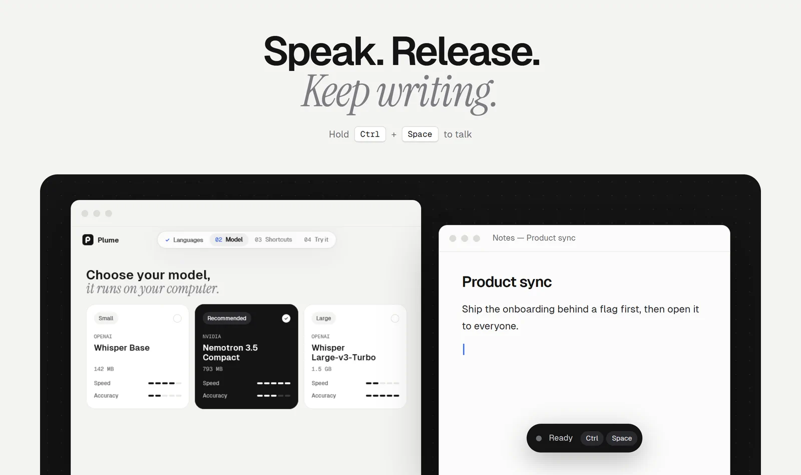

  

# Plume — offline voice dictation

Hold a shortcut, speak, release: Plume types what you said in the app you're using. Transcription runs locally, nothing is sent online.

<picture>
  <source media="(prefers-color-scheme: dark)" srcset="docs/images/plume-hero-dark.webp">
  
</picture>

## Install

Download the latest version from [Releases](https://github.com/LeoMartinDev/Plume/releases/latest):

- **macOS** (Apple Silicon): `.dmg`
- **Windows** (x64): `.exe` installer
- **Linux** (x64, Ubuntu 24.04+, X11 only): `.deb`, install with `sudo apt install ./Plume-*.deb`

Builds aren't signed, so macOS or Windows may show a security warning.

## Usage

On first launch, Plume asks you to pick a speech model and grant microphone access (plus Accessibility and Input Monitoring on macOS). It then lives in your menu bar or system tray.

| Shortcut | Action |
| --- | --- |
| **Ctrl + Space** (hold) | Record while held, insert text on release |
| **Ctrl + Shift + Space** | Start / stop hands-free recording |
| **Esc** | Cancel |

Shortcuts can be changed in **Settings → Dictation**. Recent transcriptions and the last 8 recordings are kept in history, so you can copy or retranscribe them.

## Models

| Model | Size | Languages |
| --- | --- | --- |
| Whisper Base | 142 MB | 99 |
| Whisper Small | 466 MB | 99 |
| Parakeet TDT v3 | 639 MB | 25 European |
| Nemotron 3.5 Compact | 793 MB | 35 |
| Whisper Large-v3-Turbo | 1.5 GB | 99 |

Smaller models are faster, larger ones more accurate. The app currently supports French, English and automatic detection. Parakeet TDT v3 is [NVIDIA's model](https://huggingface.co/nvidia/parakeet-tdt-0.6b-v3) (CC BY 4.0), via the [ONNX conversion by Ilya Stupakov](https://huggingface.co/istupakov/parakeet-tdt-0.6b-v3-onnx).

## Privacy

Audio and history stay on your computer. Internet is only used to download models and check for updates.

## Development

See the [development guide](docs/development.md). Bugs and ideas go in [issues](https://github.com/LeoMartinDev/Plume/issues).
